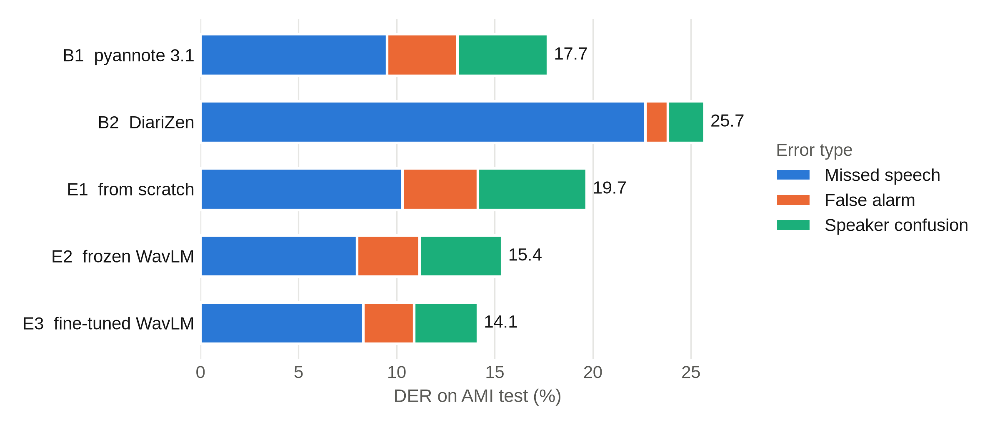

# Speaker diarization with WavLM

Who spoke when? This project trains the neural core of a speaker diarization system, the
segmentation model, on top of [WavLM](https://huggingface.co/microsoft/wavlm-base-plus), and
plugs it into the [pyannote.audio](https://github.com/pyannote/pyannote-audio) pipeline.
Everything was trained on a single laptop GPU with 6 GB of memory.

On the AMI meeting corpus the fine-tuned model reaches a diarization error rate of **14.1 %**,
against 17.7 % for the pyannote 3.1 pipeline evaluated in the same way.



| | System | DER on AMI test |
|---|---|---|
| B1 | pyannote 3.1 (ready-made) | 17.7 % |
| B2 | DiariZen (ready-made) | 25.7 % * |
| E1 | small model trained from scratch | 19.7 % |
| E2 | frozen WavLM + BiLSTM head | 15.4 % |
| E3 | fine-tuned WavLM + BiLSTM head | **14.1 %** |

\* DiariZen misses a lot of speech on this version of AMI, far from its usual quality; on
VoxConverse it is the best of the five systems (8.0 %). See the results page.

The models are trained on AMI only, so they are specialised on meetings: on other kinds of
recordings the general-purpose systems are better. All numbers, the cross-corpus test and the
error analysis are in **[RESULTS.md](RESULTS.md)**.

## Use the trained model

The fine-tuned model (E3) is on the Hugging Face Hub:
[denkry/wavlm-diarization-ami](https://huggingface.co/denkry/wavlm-diarization-ami). It does not
need this repository:

```bash
pip install torch transformers pyannote.audio soundfile
```

```python
from transformers import AutoModel

model = AutoModel.from_pretrained("denkry/wavlm-diarization-ami", trust_remote_code=True).to("cuda")

for turn, _, speaker in model.diarize("meeting.wav").itertracks(yield_label=True):
    print(f"{turn.start:7.1f}s - {turn.end:7.1f}s  {speaker}")
```

## How it works

```
audio ──> segmentation model ──> speaker embeddings ──> clustering ──> who spoke when
          (trained here)         └────────── pyannote.audio ──────────┘
```

1. **Segmentation model.** It takes 10 s of audio and, for every 20 ms frame, predicts one of
   7 classes: nobody, speaker 1, 2 or 3, or one of the three pairs (the "powerset"
   formulation, which handles overlapping speech). The loss is cross-entropy under the best
   ordering of the speakers.
2. **Whole recording.** pyannote.audio slides the model over the recording, computes a voice
   embedding for every local speaker and clusters the embeddings into global speakers. The
   number of speakers is found automatically.

The three models share the same BiLSTM head and differ only in their features:

| | Features | Trained parameters |
|---|---|---|
| E1 | log-mel spectrogram + CNN, no pre-training | 3.4 M |
| E2 | frozen WavLM Base+, learned weighted sum of its layers | 3.7 M |
| E3 | the same, with WavLM fine-tuned (starts from E2) | 93.9 M |

The baseline B1 uses the same pipeline with pyannote's own segmentation model, so B1 and
E1-E3 differ only in the segmentation model. B2 (DiariZen) is a separate, larger system with
its own pipeline.

## Setup

```bash
python3.12 -m venv .venv && source .venv/bin/activate
pip install -e .
hf auth login        # the pyannote baseline needs https://hf.co/pyannote/segmentation-3.0 to be accepted
```

## Usage

```bash
# 1. Data: AMI -> data/ami/<split>/*.flac + *.rttm   (--max-meetings 3 for a quick test)
python scripts/prepare_data.py

# 2. Train (add --resume to continue after an interruption)
python scripts/train.py --config configs/debug.yaml          # one-minute check of the code
python scripts/train.py --config configs/e1_scratch.yaml     # 0.4 h on an RTX 3050
python scripts/train.py --config configs/e2_frozen.yaml      # 4 h
python scripts/train.py --config configs/e3_finetune.yaml    # 6.6 h, needs runs/e2_frozen/best.pt

# 3. Evaluate on the test set -> one row each in results/results.csv (DER and JER)
python scripts/baseline_pyannote.py
python scripts/evaluate.py --checkpoint runs/e3_finetune/best.pt --name E3

# 4. Figures -> results/figures
python scripts/make_plots.py --layers E2=runs/e2_frozen/best.pt E3=runs/e3_finetune/best.pt \
    --training E1=runs/e1_scratch E2=runs/e2_frozen E3=runs/e3_finetune --example test_010 540 600
```

Training curves: `tensorboard --logdir runs`. The settings of every experiment are in
`configs/*.yaml`; the batch sizes are chosen for 6 GB of GPU memory.

<details>
<summary>Optional: evaluation on VoxConverse and comparison with DiariZen</summary>

A test on a corpus that the models never saw in training, with no training involved:

```bash
bash scripts/run_voxconverse.sh      # -> results/results_voxconverse.csv, results/figures_voxconverse
```

[DiariZen](https://github.com/BUTSpeechFIT/DiariZen) (system B2) needs older libraries, so it
lives in its own environment and only writes RTTM files, which are then scored with this code:

```bash
git clone https://github.com/BUTSpeechFIT/DiariZen external/DiariZen
uv venv --python 3.10 --seed .venv-diarizen
uv pip install --python .venv-diarizen/bin/python torch==2.1.1 torchvision==0.16.1 torchaudio==2.1.1 \
    --index-url https://download.pytorch.org/whl/cu121
uv pip install --python .venv-diarizen/bin/python -r external/DiariZen/requirements.txt -e external/DiariZen
(cd external/DiariZen/pyannote-audio && uv pip install --python ../../../.venv-diarizen/bin/python -e . -c ../constraints.txt)

.venv-diarizen/bin/python scripts/baseline_diarizen.py
python scripts/score_rttm.py --rttm results/rttm/B2_test --name B2
```

</details>

## Repository layout

```
configs/               one file per experiment
src/diar/data/         corpus download, chunk sampling and targets
src/diar/model/        head, WavLM model (E2, E3), log-mel model (E1)
src/diar/train/        loss and training loop
src/diar/inference/    adapter + full diarization pipeline
src/diar/eval/         DER / JER and figures
scripts/               command-line entry points
results/               result tables, figures and the system outputs (RTTM)
```

## Acknowledgements and licences

The code of this repository is released under the [MIT licence](LICENSE). It builds on:

- [AMI Meeting Corpus](https://groups.inf.ed.ac.uk/ami/corpus/) (CC BY 4.0), in the version
  [diarizers-community/ami](https://huggingface.co/datasets/diarizers-community/ami), and
  [VoxConverse](https://huggingface.co/datasets/diarizers-community/voxconverse).
- WavLM: Chen et al., 2022, [arXiv:2110.13900](https://arxiv.org/abs/2110.13900).
- pyannote.audio: Bredin, 2023, and the powerset loss of Plaquet & Bredin, 2023,
  [arXiv:2310.13025](https://arxiv.org/abs/2310.13025). Used for the pipeline, the speaker
  embeddings, the baseline and the metrics.
- DiariZen: Han et al., 2025, [arXiv:2409.09408](https://arxiv.org/abs/2409.09408). Its model
  weights are under CC BY-NC 4.0 and are not distributed here.
