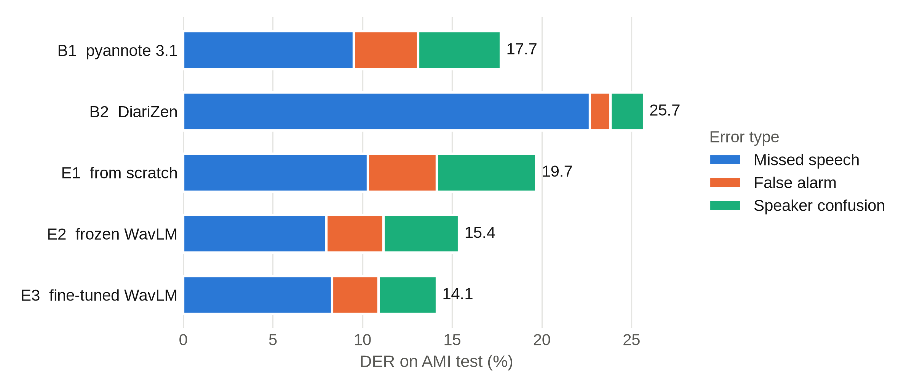
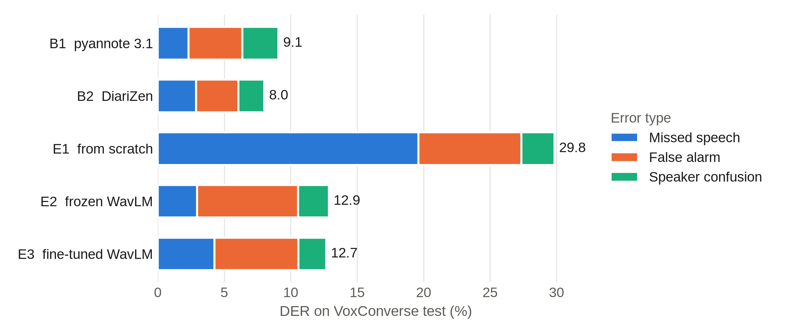
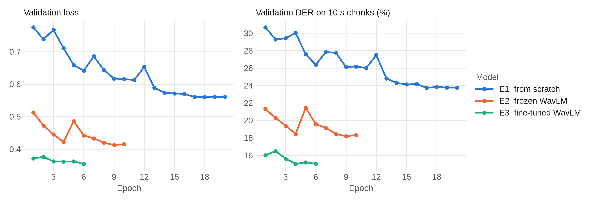
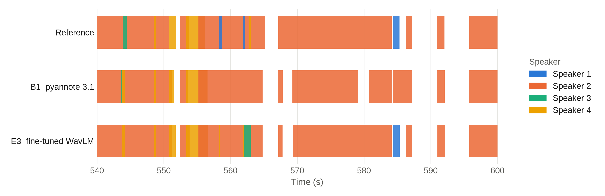
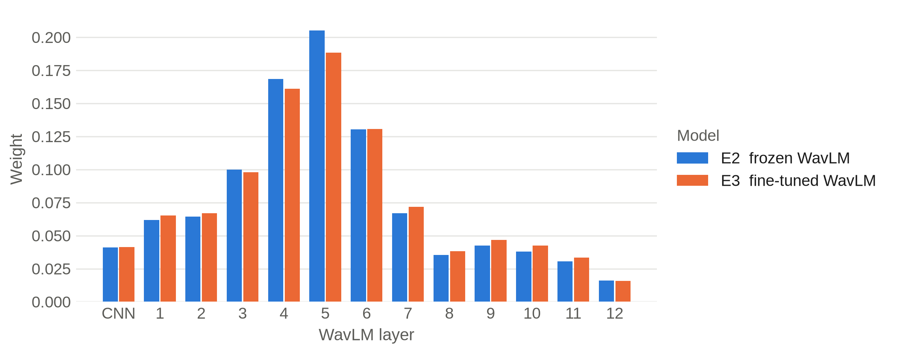

# Results

All systems diarize complete recordings without knowing the number of speakers. Numbers are
in %, lower is better.

- **DER** – diarization error rate with no collar and overlapping speech included (the strict
  setting), with its three parts: missed speech, false alarm and speaker confusion.
- **DER (collar)** – the same with 0.25 s around every reference boundary left out.
- **JER** – Jaccard error rate: the error per speaker, averaged, so every speaker counts the
  same.

| | System |
|---|---|
| B1 | pyannote 3.1 pipeline (ready-made) |
| B2 | DiariZen, WavLM Large + Conformer (ready-made) |
| E1 | log-mel + CNN + BiLSTM, trained from scratch |
| E2 | frozen WavLM Base+ + BiLSTM head |
| E3 | fine-tuned WavLM Base+ + BiLSTM head |

## AMI test set (16 meetings, 9.1 h)

| | DER | Missed | False alarm | Confusion | DER (collar) | JER |
|---|---|---|---|---|---|---|
| B1 | 17.71 | 9.52 | 3.58 | 4.61 | 11.46 | 23.80 |
| B2 | 25.69 | 22.68 | 1.14 | 1.87 | 22.16 | 28.30 |
| E1 | 19.68 | 10.30 | 3.85 | 5.54 | 12.57 | 26.12 |
| E2 | 15.38 | 7.99 | 3.18 | 4.21 | 9.60 | 22.14 |
| **E3** | **14.14** | 8.30 | 2.59 | 3.25 | **9.09** | **20.43** |

- **Pre-training matters most.** Frozen WavLM features instead of features learned from
  scratch: 19.7 → 15.4 %, with almost the same number of trained parameters.
- **Fine-tuning adds a little more:** 15.4 → 14.1 %, mostly through less speaker confusion.
- **E3 beats the pyannote baseline** by 3.6 points, and on each of the 16 meetings.
- **B2 on AMI is an outlier.** DiariZen misses 22.7 % of the speech on this version of the
  data, far from its usual quality (see VoxConverse below). The cause was not found, so this
  number says more about a data mismatch than about DiariZen.

## VoxConverse (29 test recordings, 5.8 h)

A corpus of YouTube debates and news that the E-models never saw in training.

| | DER | Missed | False alarm | Confusion | DER (collar) | JER |
|---|---|---|---|---|---|---|
| B1 | 9.08 | 2.33 | 4.03 | 2.72 | 5.16 | 31.81 |
| **B2** | **8.01** | 2.89 | 3.19 | 1.94 | **5.04** | **24.35** |
| E1 | 29.84 | 19.62 | 7.75 | 2.47 | 26.08 | 49.04 |
| E2 | 12.87 | 2.96 | 7.59 | 2.32 | 8.33 | 34.11 |
| E3 | 12.67 | 4.27 | 6.32 | 2.08 | 8.40 | 33.89 |

- **The order is reversed.** The ready-made systems, trained on many corpora (B1 also on
  VoxConverse itself), are 3.6 to 4.7 points better than E3.
- **Pre-training is what keeps the model usable.** From scratch: 29.8 %. With frozen WavLM
  and the same AMI training data: 12.9 %.
- **The gain from fine-tuning does not transfer.** E3 and E2 are equal here; fine-tuning on
  AMI made the model better at AMI, not at diarization in general.

## Training

| | E1 | E2 | E3 |
|---|---|---|---|
| Starts from | random weights | pre-trained WavLM | best E2 checkpoint |
| Batch size × steps | 32 × 20 000 | 16 × 20 000 | 4 × 48 000 |
| Time on an RTX 3050 (6 GB) | 0.4 h | 4.0 h | 6.6 h |
| Best validation DER on 10 s chunks | 23.73 | 18.18 | 15.00 |

The chunk-level DER measures the segmentation model alone and is not comparable with the DER
of complete recordings above.

## Where the errors are

Missed speech is the largest part of the error of every system (59 % of the DER of E3).
On the validation chunks, more than half of the speech that E3 misses is in overlapped frames,
although only about 10 % of the frames contain overlap:

| Frame in the reference | Share of frames | Missed speech | False alarm |
|---|---|---|---|
| Silence | 21.6 % | – | 2.3 |
| One speaker | 67.8 % | 3.3 | 1.8 |
| Two speakers | 9.7 % | 3.6 | – |
| Three speakers | 0.8 % | 1.1 | – |

A 60-second excerpt of a test meeting:

## Which WavLM layers are used

The learned weights peak at Transformer layers 4 and 5; the last layer is the least useful.
Fine-tuning barely changes them.

## Compared with published results

DER on the AMI test set (headset recordings, no collar). The published numbers come from
different data preparation and are only roughly comparable.

| System | DER | Source |
|---|---|---|
| EEND-M2F, fine-tuned on AMI | 12.6 | [Härkönen et al., 2024](https://arxiv.org/abs/2401.12600) |
| pyannoteAI precision-2 (commercial) | 12.9 | [pyannote benchmark](https://huggingface.co/pyannote/speaker-diarization-community-1) |
| EEND-M2F | 13.9 | [Härkönen et al., 2024](https://arxiv.org/abs/2401.12600) |
| **E3 (this project)** | **14.1** | |
| **E2 (this project)** | **15.4** | |
| pyannote community-1 | 17.0 | [pyannote benchmark](https://huggingface.co/pyannote/speaker-diarization-community-1) |
| pyannote 3.1 | 18.8 | [pyannote benchmark](https://huggingface.co/pyannote/speaker-diarization-community-1) |
| **E1 (this project)** | **19.7** | |

## Limitations

- Trained on one corpus (AMI), which is the main weakness outside meetings.
- One training run per model, so differences of a few tenths of a point are within noise.
- The VoxConverse test uses 29 recordings, not the complete test set.
- At most two speakers can be detected at the same moment.
- The clustering stage uses the pyannote settings and was not tuned for these models.

The raw numbers are in [`results/results.csv`](results/results.csv) and
[`results/results_voxconverse.csv`](results/results_voxconverse.csv); the outputs of every
system are in `results/rttm/`.
